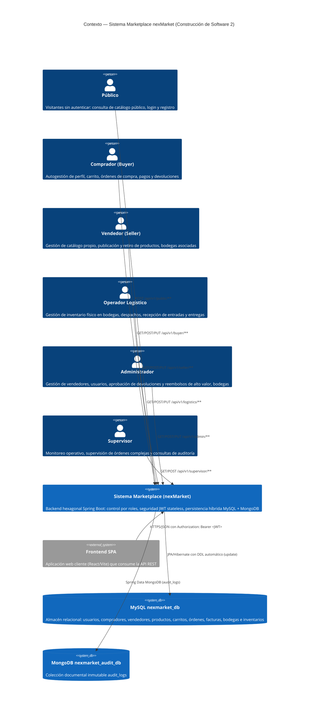

# C4 Nivel 1 — Contexto

## Propósito

Delimitar el alcance del sistema de marketplace **nexMarket**, identificar quién interactúa con él (actores humanos y roles del sistema) y con qué sistemas o almacenes de datos externos se relaciona.

Toda la lógica de negocio del marketplace (catálogo, carrito, órdenes, facturación, inventario, logística, devoluciones, auditoría y control de acceso) reside dentro del backend hexagonal. En el exterior se encuentran los usuarios (a través de una aplicación Frontend SPA), la base de datos relacional MySQL y el almacén NoSQL MongoDB para auditoría inmutable.

## Diagrama de Contexto

## Actores y Endpoints Principales

| Actor | Prefijo de Ruta | Autenticación Requerida | Operaciones Principales |
|---|---|---|---|
| **Público** | `/api/v1/public` | Ninguna (Público) | Registro de usuarios y compradores, autenticación (login con JWT), consulta de catálogo público y productos destacados |
| **Comprador** | `/api/v1/buyer` | `ROLE_BUYER` | Consulta y actualización de perfil, adición/remoción en carrito, checkout y confirmación de órdenes, seguimiento de pedidos, solicitud de devoluciones |
| **Vendedor** | `/api/v1/seller` | `ROLE_SELLER` | Registro de productos físicos/digitales, publicación y suspensión de catálogo, consulta de productos propios y bodegas |
| **Operador Logístico** | `/api/v1/logistics` | `ROLE_LOGISTICS_OPERATOR` | Consulta de inventario en bodega, registro de entradas de mercancía (inbound), ajustes de inventario, preparación y despacho de envíos |
| **Administrador** | `/api/v1/admin` | `ROLE_ADMINISTRATOR` | Registro de vendedores y bodegas, cambio de estado de usuarios/bodegas, aprobación de devoluciones y reembolsos mayores al umbral |
| **Supervisor** | `/api/v1/supervisor` | `ROLE_SUPERVISOR` | Consulta de bitácora de auditoría, supervisión de órdenes y generación de reportes administrativos |
