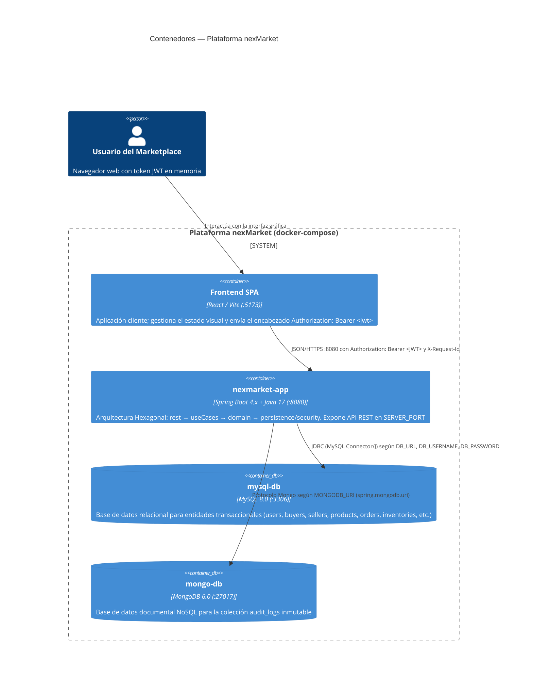
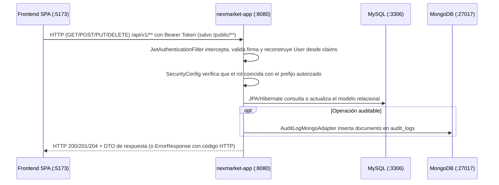

# C4 Nivel 2 — Contenedores

## Propósito

Describir la arquitectura de despliegue y ejecución de **nexMarket**, ilustrando los límites de cada contenedor, las responsabilidades de procesamiento y almacenamiento, y los protocolos de comunicación utilizados en la red.

## Diagrama de Contenedores

## Especificación de Contenedores y Variables de Entorno

| Contenedor | Imagen / Runtime | Variables de Entorno Clave | Responsabilidad y Flujo |
|---|---|---|---|
| `spa` | React / Vite (`:5173`) | `VITE_API_URL` | Interfaz de usuario; inicia los flujos de login y peticiones REST autenticadas |
| `nexmarket-app` | `nexMarket/Dockerfile` (Maven 3.9 + Temurin 17) | `DB_URL`, `DB_USERNAME`, `DB_PASSWORD`, `MONGODB_URI`, `JWT_SECRET`, `JWT_EXPIRATION_MS`, `FRONTEND_ORIGIN`, `SERVER_PORT` | Recibe peticiones HTTP, autentica mediante `JwtAuthenticationFilter`, autoriza por rol en `SecurityConfig`, orquesta casos de uso y servicios de dominio |
| `mysql-db` | `mysql:8.0` | `MYSQL_DATABASE=nexmarket_db`, `MYSQL_ROOT_PASSWORD`, `MYSQL_USER`, `MYSQL_PASSWORD` | Almacenamiento ACID de usuarios, productos, bodegas, carritos, órdenes y transacciones de negocio |
| `mongo-db` | `mongo:6.0` | Puerto `27017`, base de datos `nexmarket_audit_db` | Registro de trazabilidad de operaciones críticas en la colección `audit_logs` |

## Ciclo de Red de una Petición

### Convenciones Semánticas HTTP
* `200 OK` / `201 CREATED` / `204 NO CONTENT`: Operación completada con éxito.
* `400 BAD REQUEST`: Error de validación en los datos de entrada (`@Valid`).
* `401 UNAUTHORIZED`: Credenciales inválidas o ausencia de token en ruta protegida.
* `403 FORBIDDEN`: Token expirado, versión de token obsoleta o rol insuficiente para el prefijo de la ruta.
* `404 NOT FOUND`: Recurso no encontrado (manejado por `GlobalExceptionHandler` con envelope `ErrorResponse`).
