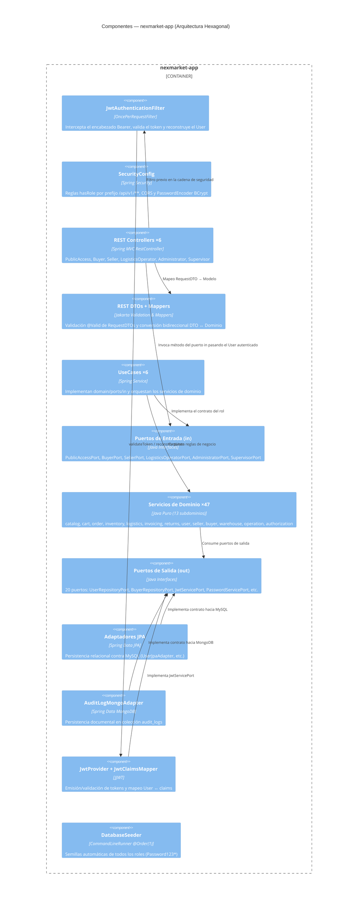
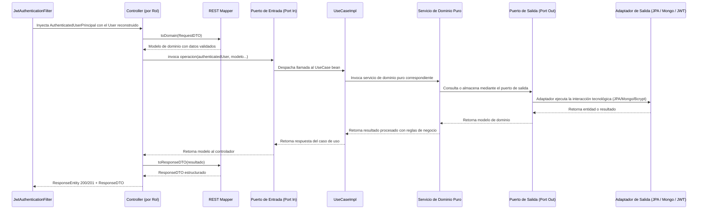

# C4 Nivel 3 — Componentes

## Propósito

Descomponer el contenedor **`nexmarket-app`** para detallar los componentes que participan en el ciclo de vida de cada petición: controladores REST, adaptadores de casos de uso, servicios de dominio, puertos y adaptadores secundarios.

## Diagrama de Componentes

## Ciclo de Vida de una Petición Hexagonal

El siguiente diagrama de secuencia representa la interacción entre componentes para cualquier endpoint del marketplace:

