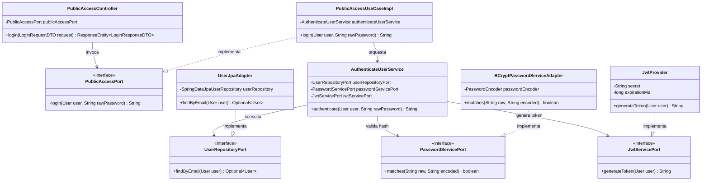

# C4 Nivel 4 — Código

## Propósito

Ilustrar las clases Java clave y su colaboración en tiempo de diseño y ejecución para un flujo de negocio típico, permitiendo a cualquier desarrollador navegar entre controladores, casos de uso, servicios de dominio y adaptadores de infraestructura sin ambigüedad.

## Mapa de Paquetes y Clases Reales

* **Controladores y Mappers REST (`adapters/rest/`):**
  * `PublicAccessController`, `BuyerController`, `SellerController`, `LogisticsOperatorController`, `AdministratorController`, `SupervisorController`.
  * `UserRestMapper`, `BuyerRestMapper`, `ProductRestMapper`, `CartRestMapper`, `OrderRestMapper`, `LogisticsRestMapper`, `ReturnRestMapper`, `AuditLogRestMapper`.
  * `GlobalExceptionHandler`, `ErrorResponse`.
* **Casos de Uso (`adapters/useCases/`):**
  * `PublicAccessUseCaseImpl`, `BuyerUseCaseImpl`, `SellerUseCaseImpl`, `LogisticsOperatorUseCaseImpl`, `AdministratorUseCaseImpl`, `SupervisorUseCaseImpl`.
* **Puertos de Entrada (`domain/ports/in/`):**
  * `PublicAccessPort`, `BuyerPort`, `SellerPort`, `LogisticsOperatorPort`, `AdministratorPort`, `SupervisorPort`.
* **Modelo de Dominio Puro (`domain/models/`):**
  * Jerarquía de Usuarios: `User` (abstracto) $\rightarrow$ `Buyer`, `Seller`, `LogisticsOperator`, `Administrator`, `Supervisor`.
  * Jerarquía de Productos: `Product` (abstracto) $\rightarrow$ `PhysicalProduct`, `DigitalProduct`.
  * Jerarquía de Procesos: `TrackableProcess` (abstracto) $\rightarrow$ `Order`, `Shipment`, `Return`, `Refund`.
  * Modelos de Soporte: `ShoppingCart`, `CartItem`, `OrderItem`, `Inventory`, `Warehouse`, `Invoice`, `AuditLog`.
* **Servicios de Dominio Puros (`domain/services/`):**
  * 47 servicios puros organizados en subdominios: `user`, `buyer`, `seller`, `catalog`, `cart`, `order`, `inventory`, `logistics`, `invoicing`, `returns`, `warehouse`, `operation`, `authorization`.
* **Puertos de Salida (`domain/ports/out/`):**
  * 20 contratos: `UserRepositoryPort`, `BuyerRepositoryPort`, `SellerRepositoryPort`, `ProductRepositoryPort`, `CartRepositoryPort`, `OrderRepositoryPort`, `InventoryRepositoryPort`, `WarehouseRepositoryPort`, `InvoiceRepositoryPort`, `ReturnRepositoryPort`, `RefundRepositoryPort`, `AuditLogRepositoryPort`, `JwtServicePort`, `PasswordServicePort`, `AuthorizationPort`, `BusinessConfigurationPort`, `NotificationPort`, etc.
* **Adaptadores de Salida (`adapters/`):**
  * `adapters/persistence/jpa/`: `UserJpaAdapter`, `UserJpaEntity`, `SpringDataJpaUserRepository`, `UserJpaMapper`.
  * `adapters/persistence/mongodb/`: `AuditLogMongoAdapter`, `AuditLogDocument`, `AuditLogMongoRepository`, `AuditLogMongoMapper`.
  * `adapters/security/`: `JwtProvider`, `JwtClaimsMapper`, `JwtAuthenticationFilter`, `SecurityConfig`, `BCryptPasswordServiceAdapter`, `MarketUserDetailsAdapter`, `dtos/AuthenticatedUserPrincipal`, `dtos/JwtClaimsDTO`.
  * `adapters/config/`: `DefaultBusinessConfigurationAdapter`.
  * `adapters/notification/`: `NoOpNotificationAdapter`.

## Diagrama de Clases — Flujo Canónico de Autenticación (`POST /api/v1/public/login`)

