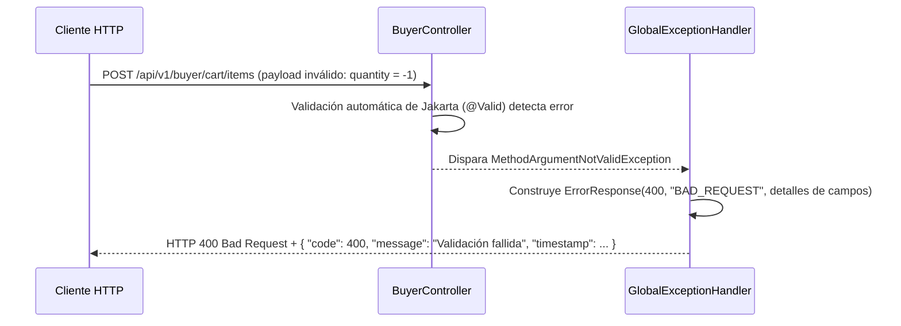

# Capa — Adaptadores REST

## Propósito

El paquete `application/adapters/rest/` constituye el adaptador primario (driver) de entrada HTTP al hexágono. Expone la API RESTful del marketplace, deserializa y valida sintácticamente las solicitudes, mapea los DTOs hacia los modelos de dominio, delega a los puertos de entrada (`domain/ports/in`) y captura de forma centralizada cualquier excepción producida en las capas internas para entregar respuestas JSON homogéneas.

## Estructura de Paquetes

```text
application/adapters/rest/
├── controllers/    # Controladores REST segregados por rol y prefijo de ruta
├── dtos/
│   ├── requests/   # Objetos de transferencia de entrada con validaciones @Valid
│   └── responses/  # Objetos de transferencia de salida inmutables con @Builder
├── mappers/        # Clases de utilidad estática para conversión DTO ↔ Dominio
└── exception/      # GlobalExceptionHandler (@RestControllerAdvice) y ErrorResponse
```

## Controladores por Rol

| Controlador | Prefijo de Ruta | Rol Autorizado | Métodos Expuestos |
|---|---|---|---|
| `PublicAccessController` | `/api/v1/public` | Ninguno (Público) | `POST /register`, `POST /login`, `GET /catalog`, `GET /products/{id}` |
| `BuyerController` | `/api/v1/buyer` | `ROLE_BUYER` | `GET/PUT /profile`, `GET/POST/PUT/DELETE /cart/**`, `POST/GET /orders/**`, `POST /returns` |
| `SellerController` | `/api/v1/seller` | `ROLE_SELLER` | `POST /products`, `PUT /products/{id}`, `GET /products`, `PATCH /products/{id}/status` |
| `LogisticsOperatorController` | `/api/v1/logistics` | `ROLE_LOGISTICS_OPERATOR` | `GET /warehouses`, `GET /inventory`, `POST /inventory/inbound`, `POST /inventory/adjustment`, `POST /shipments/**` |
| `AdministratorController` | `/api/v1/admin` | `ROLE_ADMINISTRATOR` | `POST /sellers`, `POST /warehouses`, `PATCH /users/{id}/status`, `POST /refunds/process` |
| `SupervisorController` | `/api/v1/supervisor` | `ROLE_SUPERVISOR` | `GET /audit-logs`, `GET /orders/supervised`, `GET /reports/summary` |

## Manejo Centralizado de Excepciones

`GlobalExceptionHandler` captura las excepciones emitidas por el dominio y la infraestructura, traduciéndolas al DTO homogéneo `ErrorResponse`:

| Excepción Origen | Código HTTP | Significado |
|---|---|---|
| `MethodArgumentNotValidException` | `400 BAD REQUEST` | Falla de validación en campos del RequestDTO (`@NotBlank`, `@Positive`, etc.) |
| `DomainException` / `BusinessRuleException` | `400 BAD REQUEST` | Violación de regla de negocio en servicios puros del dominio |
| `EntityNotFoundException` | `404 NOT FOUND` | Entidad solicitada no existe en el repositorio |
| `UnauthorizedOperationException` | `401 UNAUTHORIZED` | Credenciales inválidas o cuenta inactiva/bloqueada |
| `AccessDeniedException` | `403 FORBIDDEN` | El rol del usuario autenticado no posee permiso para la operación |
| `Exception` (cualquier otra no controlada) | `500 INTERNAL SERVER ERROR` | Error no esperado del servidor |

## Diagrama de Secuencia — Validación REST y Retorno de Error


