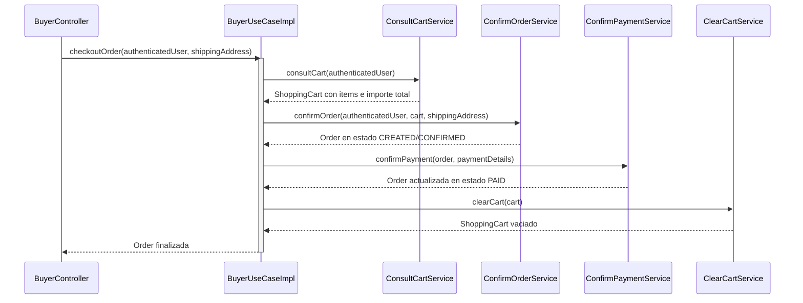

# Capa — Adaptadores de Casos de Uso

## Propósito

El paquete `application/adapters/useCases/` contiene los adaptadores que implementan los contratos definidos en los puertos de entrada (`domain/ports/in/`). Su responsabilidad consiste en orquestar uno o varios servicios de dominio puros, coordinando transacciones y flujos complejos sin incorporar lógica de negocio propia.

## Segregación por Rol

Siguiendo el estándar del proyecto de referencia, los puertos de entrada no se diseñan como interfaces de un solo método CRUD genérico, sino como **contratos de rol** cohesivos que agrupan todas las operaciones que un actor del sistema puede ejecutar:

```text
application/adapters/useCases/
├── PublicAccessUseCaseImpl.java       implements PublicAccessPort
├── BuyerUseCaseImpl.java              implements BuyerPort
├── SellerUseCaseImpl.java             implements SellerPort
├── LogisticsOperatorUseCaseImpl.java  implements LogisticsOperatorPort
├── AdministratorUseCaseImpl.java      implements AdministratorPort
└── SupervisorUseCaseImpl.java         implements SupervisorPort
```

## Matriz de Casos de Uso y Servicios Orquestados

| Caso de Uso | Puerto de Entrada | Servicios de Dominio Inyectados |
|---|---|---|
| `PublicAccessUseCaseImpl` | `PublicAccessPort` | `RegisterUserService`, `RegisterBuyerService`, `AuthenticateUserService`, `ConsultPublicCatalogService`, `ConsultProductService` |
| `BuyerUseCaseImpl` | `BuyerPort` | `ConsultBuyerService`, `UpdateBuyerAddressesService`, `AddItemToCartService`, `RemoveItemFromCartService`, `UpdateCartItemService`, `ConsultCartService`, `ClearCartService`, `ConfirmOrderService`, `ConfirmPaymentService`, `ConsultOrderService`, `RequestReturnService` |
| `SellerUseCaseImpl` | `SellerPort` | `RegisterProductService`, `PublishProductService`, `SuspendProductService`, `DiscontinueProductService`, `ConsultSellerProductsService`, `ConsultSellerService` |
| `LogisticsOperatorUseCaseImpl` | `LogisticsOperatorPort` | `ConsultInventoryService`, `RegisterInboundMovementService`, `RegisterInventoryAdjustmentService`, `PrepareShipmentService`, `DispatchShipmentService`, `ConfirmShipmentDeliveryService`, `ConsultWarehouseService` |
| `AdministratorUseCaseImpl` | `AdministratorPort` | `RegisterSellerService`, `RegisterWarehouseService`, `ChangeUserStatusService`, `ChangeSellerStatusService`, `ChangeWarehouseStatusService`, `ChangeBuyerCommercialStatusService`, `ApproveReturnService`, `ProcessRefundService`, `RejectRefundService` |
| `SupervisorUseCaseImpl` | `SupervisorPort` | `ConsultAuditLogService`, `GenerateAdministrativeReportService`, `ConsultOrderService` |

## Diagrama de Secuencia — Orquestación de Caso de Uso


