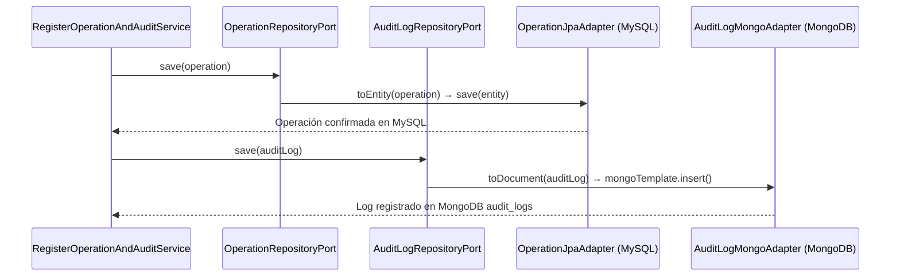

# Capa — Adaptadores de Persistencia

## Propósito

El paquete `application/adapters/persistence/` agrupa los adaptadores secundarios que implementan los puertos de salida de repositorios (`*RepositoryPort`). Aplica una estrategia de **persistencia políglota**:
1. **Relacional (MySQL vía JPA/Hibernate):** Para el estado transaccional ACID del marketplace (usuarios, productos, bodegas, carritos, órdenes, facturas, inventarios).
2. **Documental NoSQL (MongoDB vía Spring Data Mongo):** Para la colección inmutable de bitácoras de auditoría (`audit_logs`), garantizando alto rendimiento en inserciones append-only sin sobrecargar la base de datos relacional.

## Estructura de Paquetes

```text
application/adapters/persistence/
├── jpa/                        # Adaptadores relacionales MySQL
│   ├── entities/               # Entidades JPA (@Entity, @Table, @Column)
│   ├── repositories/           # Interfaces Spring Data JpaRepository
│   ├── mappers/                # Mapeo bidireccional JPA Entity ↔ Modelo de Dominio
│   └── adapters/               # Clases @Repository que implementan los puertos out
└── mongodb/                    # Adaptadores documentales MongoDB
    ├── documents/              # Documentos Mongo (@Document(collection = "audit_logs"))
    ├── repositories/           # Interfaces MongoRepository
    ├── mappers/                # Mapeo Document ↔ AuditLog de dominio
    └── adapters/               # Clases @Repository que implementan AuditLogRepositoryPort
```

## Aislamiento Estricto del Dominio

* Los modelos ubicados en `domain/models/` **nunca** contienen anotaciones como `@Entity`, `@Table`, `@Id`, `@GeneratedValue`, `@Column`, `@Document` ni referencias a Jakarta Persistence o Spring Data.
* La traducción entre el modelo de datos relacional/documental y el modelo de dominio puro se realiza exclusivamente dentro de los mappers de persistencia (`UserJpaMapper`, `AuditLogMongoMapper`, etc.).

## Implementaciones Destacadas

### 1. `UserJpaAdapter`
* **Puerto implementado:** `application.domain.ports.out.UserRepositoryPort`.
* **Entidad relacional:** `UserJpaEntity` (tabla `users` con columnas `identifier`, `name`, `email`, `password`, `role`, `status`, `auth_token_version`).
* **Instanciación polimórfica:** `UserJpaMapper.toDomain` evalúa el campo `role` para instanciar la subclase concreta correspondiente (`Buyer`, `Seller`, `LogisticsOperator`, `Administrator`, `Supervisor`).

### 2. `AuditLogMongoAdapter`
* **Puerto implementado:** `application.domain.ports.out.AuditLogRepositoryPort`.
* **Documento NoSQL:** `AuditLogDocument` en colección `audit_logs` con índices en `operationDate`, `performedByIdentifier` y `userRole`.

## Diagrama de Secuencia — Persistencia Relacional y Documental


