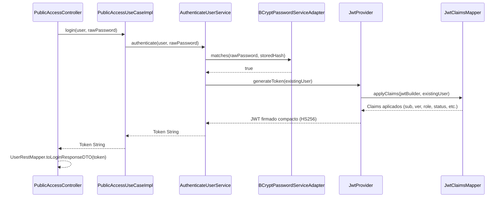
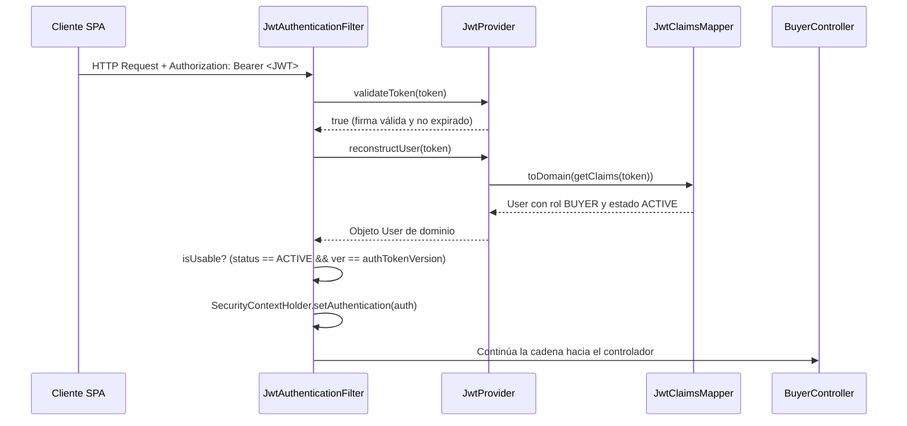

# Capa — Adaptador de Seguridad

## Propósito

El paquete `application/adapters/security/` (+ `dtos/` y `mappers/`) centraliza los adaptadores que satisfacen los puertos de salida de seguridad (`JwtServicePort`, `PasswordServicePort`, `AuthorizationPort`) y suministra la integración con Spring Security (`JwtAuthenticationFilter`, `SecurityConfig`, `MarketUserDetailsAdapter`).

## Componentes y Responsabilidades

| Clase | Paquete | Rol Arquitectónico |
|---|---|---|
| `JwtProvider` | `adapters.security` | Implementa `JwtServicePort`: emisión (`generateToken`), validación criptográfica (`validateToken`), extracción de claims y reconstrucción del usuario (`reconstructUser`) sin round-trip a BD |
| `dtos/JwtClaimsDTO` | `adapters.security.dtos` | Snapshot serializable del `User` firmado en el JWT (`ver`, `identifier`, `fullName`, `email`, `role`, `status`, `primaryAddress`, `commercialStatus`) |
| `mappers/JwtClaimsMapper` | `adapters.security.mappers` | Conversión bidireccional pura: `User ↔ JwtClaimsDTO ↔ Map<String, Object> ↔ Claims`. Reconstruye la subclase concreta (`Buyer`, `Seller`, etc.) según el rol |
| `dtos/AuthenticatedUserPrincipal` | `adapters.security.dtos` | Implementa `UserDetails` de Spring Security; expone autoridades con prefijo `ROLE_<USER_ROLE>` y estado de bloqueo según `UserStatus` |
| `MarketUserDetailsAdapter` | `adapters.security` | Implementa `UserDetailsService`: parsea el identificador, delega al servicio de dominio `LoadAuthenticatedUserService`, envuelve en el principal y traduce a `UsernameNotFoundException` |
| `BCryptPasswordServiceAdapter` | `adapters.security` | Implementa `PasswordServicePort` utilizando el algoritmo estándar `BCryptPasswordEncoder` |
| `DefaultAuthorizationAdapter` | `adapters.security` | Implementa `AuthorizationPort`: verifica si un usuario tiene permisos sobre un comprador o sobre un proceso trazable |
| `JwtAuthenticationFilter` | `adapters.security` | Filtro `OncePerRequestFilter`: extrae `Bearer <token>`, valida firma, reconstruye el `User`, verifica versión y estado activo, y establece la autenticación en `SecurityContextHolder` |
| `SecurityConfig` | `adapters.security` | Configuración web: sesión `STATELESS`, reglas `hasRole` por prefijo, deshabilitación de `anonymous`, filtros JWT y orígenes CORS según `FRONTEND_ORIGIN` |

## Decisión de Diseño: Autenticación Stateless sin Round-Trip a BD

Para maximizar el rendimiento y escalabilidad, el token JWT embebe el snapshot completo del usuario:
1. `JwtClaimsMapper` serializa el rol, identificador, nombre y estado en los claims del token.
2. En cada petición, `JwtAuthenticationFilter` valida criptográficamente la firma con la clave simétrica HS256 y reconstruye el objeto `User` directamente desde los claims.
3. El claim de versión (`ver`) contrastado con `User.authTokenVersion` permite invalidar tokens anteriores ante cambios de contraseña, revocaciones de permisos o cierres de sesión forzados.

## Secuencia — Emisión de Token en Login (`POST /api/v1/public/login`)

## Secuencia — Validación de Petición Protegida

