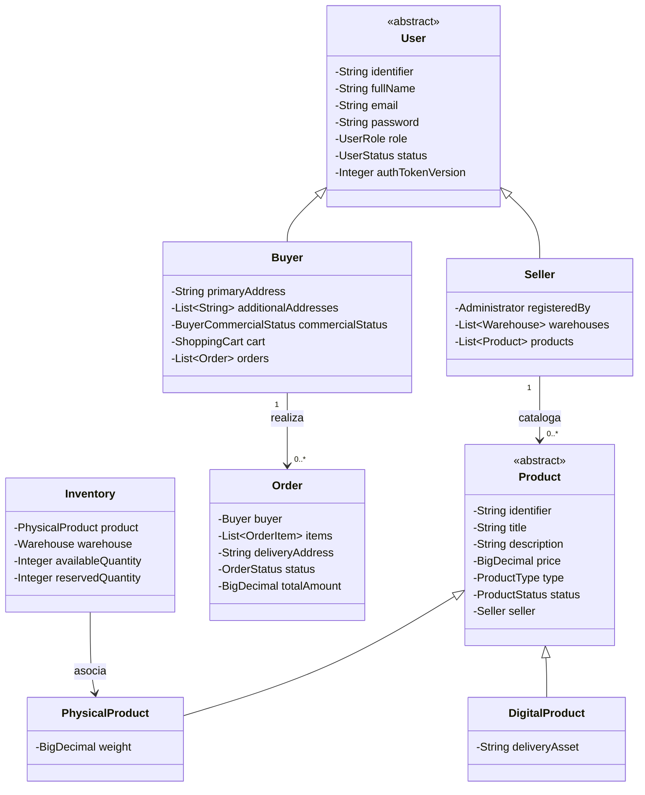

# Capa — Dominio Puro

## Propósito

El paquete `application/domain/` alberga el núcleo de la lógica del marketplace. Diseñado bajo los principios de **Domain-Driven Design (DDD)** y Arquitectura Hexagonal, es estrictamente independiente de cualquier tecnología de infraestructura o framework web (sin anotaciones de Spring, Jakarta o persistencia).

## Estructura de Paquetes

```text
application/domain/
├── models/         # Entidades de dominio y agregados
├── enums/          # Enumeraciones puras de decisión operativa (ApprovalDecision, AuditSeverity, NotificationChannel)
├── valueObjects/   # Tipos de valor inmutables y estados de procesos (UserRole, UserStatus, OrderStatus, etc.)
├── exceptions/     # Excepciones de negocio tipadas
├── ports/
│   ├── in/         # Puertos de entrada por rol (contratos hacia useCases)
│   └── out/        # Puertos de salida (contratos hacia persistencia/seguridad)
└── services/       # 47 servicios de dominio puros en 13 subdominios
```

## Jerarquías de Modelos de Dominio

### 1. Jerarquía de Usuarios
* `User` (abstracto): Contiene `identifier`, `fullName`, `email`, `password`, `role`, `status`, `authTokenVersion`.
  * `Buyer`: Extiende `User` con `primaryAddress`, `additionalAddresses`, `commercialStatus`, `cart`, `orders`.
  * `Seller`: Extiende `User` con `registeredBy`, `warehouses`, `products`.
  * `LogisticsOperator`: Extiende `User` con bodegas asignadas.
  * `Administrator`: Extiende `User` con permisos de supervisión global.
  * `Supervisor`: Extiende `User` con facultades de auditoría y reportes.

### 2. Jerarquía de Productos
* `Product` (abstracto): Contiene `identifier`, `title`, `description`, `price`, `type`, `status`, `seller`.
  * `PhysicalProduct`: Extiende `Product` con `weight` (`BigDecimal`), dimensiones y requerimientos de empaque.
  * `DigitalProduct`: Extiende `Product` con `deliveryAsset` (enlace de descarga o licencia digital).

### 3. Jerarquía de Procesos Trazables
* `TrackableProcess` (abstracto): Define un `identifier` rastreable.
  * `Order`: Carrito convertido en compra, ítems, dirección de envío, estado (`OrderStatus`) y total.
  * `Shipment`: Envío logístico, transportista, bodega origen, tracking y estado (`ShipmentStatus`).
  * `Return`: Solicitud de devolución de ítems, motivo y estado (`ReturnStatus`).
  * `Refund`: Reembolso monetario asociado a una devolución o cancelación, estado (`RefundStatus`).

## Diagrama de Clases — Agregados del Dominio



## Servicios de Dominio (13 Subdominios, 47 Servicios)

1. **`authorization/`:** `ValidatePermissionsService`.
2. **`buyer/`:** `RegisterBuyerService`, `ConsultBuyerService`, `ConsultBuyerOrdersService`, `UpdateBuyerAddressesService`, `ChangeBuyerCommercialStatusService`.
3. **`cart/`:** `AddItemToCartService`, `RemoveItemFromCartService`, `UpdateCartItemService`, `ConsultCartService`, `ClearCartService`.
4. **`catalog/`:** `RegisterProductService`, `PublishProductService`, `SuspendProductService`, `DiscontinueProductService`, `ConsultProductService`, `ConsultPublicCatalogService`.
5. **`inventory/`:** `RegisterInventoryService`, `ConsultInventoryService`, `ReserveInventoryService`, `RegisterInboundMovementService`, `RegisterInventoryAdjustmentService`, `RegisterSaleOutboundMovementService`, `RegisterReturnInboundMovementService`.
6. **`invoicing/`:** `IssueInvoiceService`, `ConsultInvoiceService`.
7. **`logistics/`:** `PrepareShipmentService`, `DispatchShipmentService`, `ConfirmShipmentDeliveryService`, `ConsultShipmentService`.
8. **`operation/`:** `RegisterOperationAndAuditService`, `ConsultAuditLogService`, `GenerateAdministrativeReportService`.
9. **`order/`:** `ConfirmOrderService`, `ConfirmPaymentService`, `DispatchOrderService`, `ConfirmDeliveryService`, `ConsultOrderService`.
10. **`returns/`:** `RequestReturnService`, `ApproveReturnService`, `RejectReturnService`, `ProcessRefundService`, `RejectRefundService`.
11. **`seller/`:** `RegisterSellerService`, `ConsultSellerService`, `ConsultSellerProductsService`, `ChangeSellerStatusService`.
12. **`user/`:** `RegisterUserService`, `AuthenticateUserService`, `ConsultUserService`, `UpdateUserService`, `ChangeUserStatusService`, `LoadAuthenticatedUserService`.
13. **`warehouse/`:** `RegisterWarehouseService`, `ConsultWarehouseService`, `ChangeWarehouseStatusService`.
