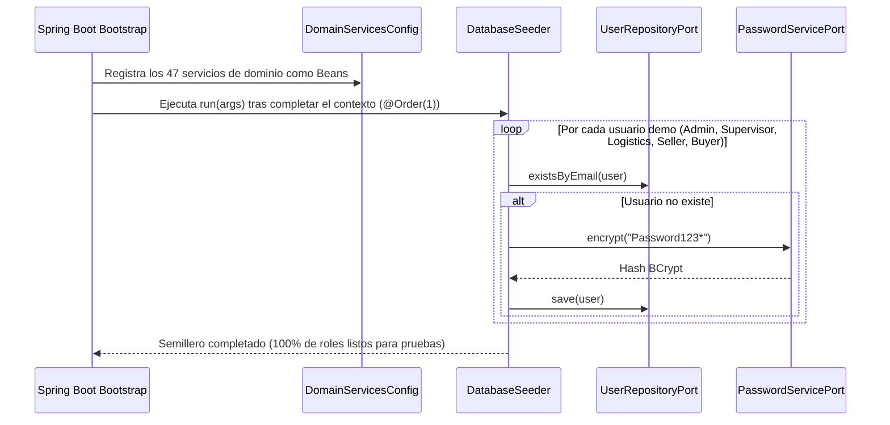

# Capa — Infraestructura

## Propósito

El paquete `application/infrastructure/` concentra los componentes de soporte técnico, configuración de contexto Spring y aprovisionamiento inicial de datos requeridos para que la aplicación arranque de manera autónoma e idempotente.

## Componentes

```text
application/infrastructure/
├── config/             # Configuración de beans de dominio (DomainServicesConfig)
└── seed/               # Semillas de base de datos para pruebas y ejecución inicial (DatabaseSeeder)
```

### 1. `DomainServicesConfig` (`@Configuration`)
Permite mantener los 47 servicios de dominio como clases Java puras (sin `@Service` ni anotaciones de Spring), instanciándolos explícitamente como Spring Beans mediante inyección por constructor de sus dependencias (`*RepositoryPort`, `JwtServicePort`, `PasswordServicePort`, `AuthorizationPort`).

### 2. `DatabaseSeeder` (`CommandLineRunner`, `@Order(1)`)
Garantiza que la plataforma cuente inmediatamente con cuentas operativas para cada uno de los roles del marketplace tras el primer arranque, utilizando la credencial estándar académica `Password123*`:

| Usuario Semilla | Correo Electrónico | Rol Asignado | Estado Inicial | Propósito en Pruebas |
|---|---|---|---|---|
| Administrador General | `admin@nexmarket.com` | `ROLE_ADMINISTRATOR` | `ACTIVE` | Gestión de vendedores, bodegas y aprobaciones |
| Supervisor Operativo | `supervisor@nexmarket.com` | `ROLE_SUPERVISOR` | `ACTIVE` | Auditoría NoSQL y supervisión de pedidos |
| Operador Logístico | `logistics@nexmarket.com` | `ROLE_LOGISTICS_OPERATOR` | `ACTIVE` | Entradas de inventario y despacho de envíos |
| Vendedor Tecnológico | `seller@nexmarket.com` | `ROLE_SELLER` | `ACTIVE` | Publicación de catálogo físico y digital |
| Santiago Comprador | `buyer@nexmarket.com` | `ROLE_BUYER` | `ACTIVE` | Pruebas de carrito, checkout y devoluciones |
| Comprador Bloqueado | `blocked@nexmarket.com` | `ROLE_BUYER` | `BLOCKED` | Validación de rechazo `401/403` por estado inactivo/bloqueado |

El sembrado es **idempotente**: evalúa `userRepositoryPort.existsByEmail(...)` antes de persistir, evitando duplicados en reinicios de contenedores.

## Diagrama de Secuencia — Arranque del Contenedor y Semillero


