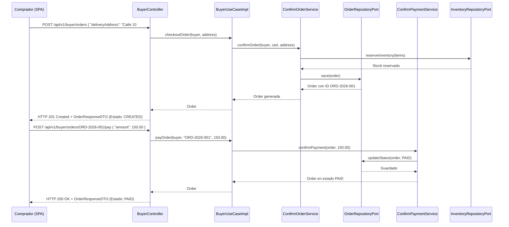
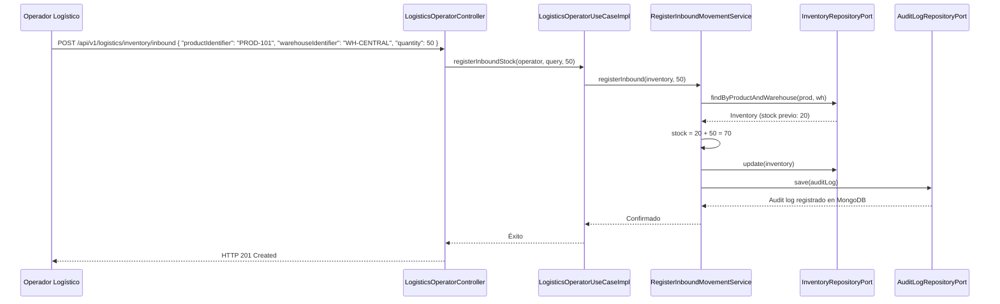
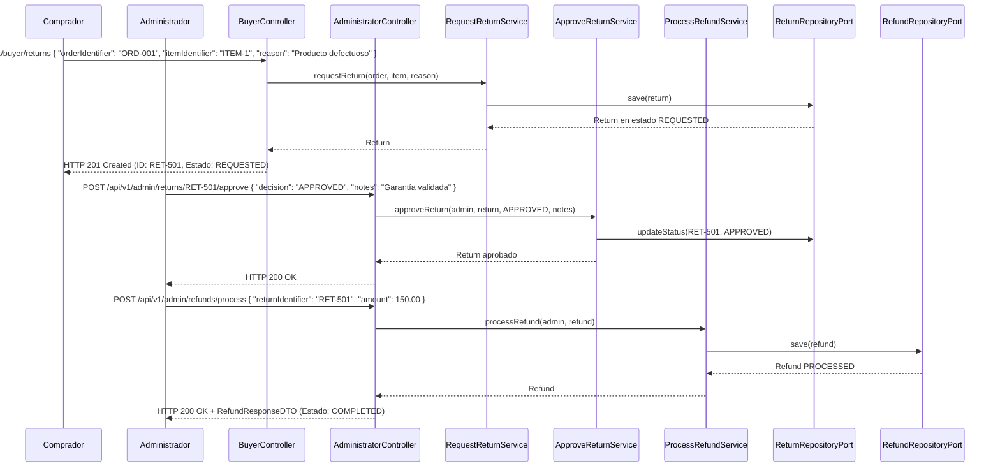

# C4 — Matriz de Endpoints y Flujos

## Propósito

Detallar exhaustivamente la matriz de endpoints expuestos por **nexMarket**, especificando método HTTP, ruta, nivel de seguridad requerido, DTOs de entrada y salida, junto con diagramas de secuencia Mermaid para los flujos de negocio más importantes de la plataforma.

---

## 1. Matriz de Endpoints

### 1.1. Acceso Público (`/api/v1/public`) — Sin Autenticación

| Método | Endpoint | Seguridad | Request DTO | Response DTO / Estado | Descripción |
|---|---|---|---|---|---|
| `POST` | `/api/v1/public/register/user` | Pública | `RegisterUserRequestDTO` | `UserResponseDTO` (201) | Registro básico de usuario |
| `POST` | `/api/v1/public/register/buyer` | Pública | `RegisterBuyerRequestDTO` | `BuyerResponseDTO` (201) | Registro de comprador con dirección |
| `POST` | `/api/v1/public/login` | Pública | `LoginRequestDTO` | `LoginResponseDTO` (200) | Autenticación y entrega de JWT |
| `GET` | `/api/v1/public/catalog` | Pública | — | `List<ProductResponseDTO>` (200) | Catálogo de productos disponibles |
| `GET` | `/api/v1/public/products/{id}` | Pública | — | `ProductResponseDTO` (200) | Detalle de un producto |

---

### 1.2. Comprador (`/api/v1/buyer`) — `ROLE_BUYER`

| Método | Endpoint | Seguridad | Request DTO | Response DTO / Estado | Descripción |
|---|---|---|---|---|---|
| `GET` | `/api/v1/buyer/profile` | `ROLE_BUYER` | — | `BuyerResponseDTO` (200) | Consulta del perfil del comprador |
| `PUT` | `/api/v1/buyer/profile/addresses` | `ROLE_BUYER` | `UpdateAddressesRequestDTO`| `BuyerResponseDTO` (200) | Actualización de direcciones |
| `GET` | `/api/v1/buyer/cart` | `ROLE_BUYER` | — | `CartResponseDTO` (200) | Consulta de carrito activo |
| `POST` | `/api/v1/buyer/cart/items` | `ROLE_BUYER` | `AddItemToCartRequestDTO` | `Void` (201) | Adición de producto al carrito |
| `PUT` | `/api/v1/buyer/cart/items/{id}` | `ROLE_BUYER` | Cantidad en query param | `Void` (200) | Actualización de cantidad de ítem |
| `DELETE` | `/api/v1/buyer/cart/items/{id}` | `ROLE_BUYER` | — | `Void` (204) | Remoción de ítem del carrito |
| `DELETE` | `/api/v1/buyer/cart` | `ROLE_BUYER` | — | `Void` (204) | Vaciado completo del carrito |
| `POST` | `/api/v1/buyer/orders` | `ROLE_BUYER` | Dirección en body | `OrderResponseDTO` (201) | Checkout y creación de orden |
| `POST` | `/api/v1/buyer/orders/{id}/pay` | `ROLE_BUYER` | Método y monto | `OrderResponseDTO` (200) | Confirmación de pago de orden |
| `GET` | `/api/v1/buyer/orders` | `ROLE_BUYER` | — | `List<OrderResponseDTO>` (200) | Historial de órdenes del comprador |
| `GET` | `/api/v1/buyer/orders/{id}` | `ROLE_BUYER` | — | `OrderResponseDTO` (200) | Detalle de orden específica |
| `POST` | `/api/v1/buyer/returns` | `ROLE_BUYER` | `RequestReturnRequestDTO` | `ReturnResponseDTO` (201) | Solicitud de devolución de ítem |

---

### 1.3. Vendedor (`/api/v1/seller`) — `ROLE_SELLER`

| Método | Endpoint | Seguridad | Request DTO | Response DTO / Estado | Descripción |
|---|---|---|---|---|---|
| `POST` | `/api/v1/seller/products` | `ROLE_SELLER` | `RegisterProductRequestDTO`| `ProductResponseDTO` (201) | Registro de producto en catálogo |
| `PUT` | `/api/v1/seller/products/{id}` | `ROLE_SELLER` | `UpdateProductRequestDTO` | `ProductResponseDTO` (200) | Actualización de precio/título |
| `PATCH` | `/api/v1/seller/products/{id}/publish` | `ROLE_SELLER` | — | `Void` (200) | Publicación de producto activo |
| `PATCH` | `/api/v1/seller/products/{id}/suspend` | `ROLE_SELLER` | — | `Void` (200) | Suspensión temporal de venta |
| `PATCH` | `/api/v1/seller/products/{id}/discontinue` | `ROLE_SELLER` | — | `Void` (200) | Retiro definitivo del catálogo |
| `GET` | `/api/v1/seller/products` | `ROLE_SELLER` | — | `List<ProductResponseDTO>` (200) | Consulta de productos del vendedor |
| `GET` | `/api/v1/seller/profile` | `ROLE_SELLER` | — | `SellerResponseDTO` (200) | Información y bodegas asignadas |

---

### 1.4. Operador Logístico (`/api/v1/logistics`) — `ROLE_LOGISTICS_OPERATOR`

| Método | Endpoint | Seguridad | Request DTO | Response DTO / Estado | Descripción |
|---|---|---|---|---|---|
| `GET` | `/api/v1/logistics/warehouses` | `ROLE_LOGISTICS_OPERATOR` | — | `List<WarehouseResponseDTO>` (200) | Bodegas operadas |
| `GET` | `/api/v1/logistics/inventory` | `ROLE_LOGISTICS_OPERATOR` | Producto y bodega query | `InventoryResponseDTO` (200) | Stock disponible y reservado |
| `POST` | `/api/v1/logistics/inventory/inbound` | `ROLE_LOGISTICS_OPERATOR` | `InboundStockRequestDTO` | `Void` (201) | Registro de entrada de stock |
| `POST` | `/api/v1/logistics/inventory/adjustment` | `ROLE_LOGISTICS_OPERATOR` | `InventoryAdjustmentRequestDTO` | `Void` (200) | Ajuste por merma o inventario |
| `POST` | `/api/v1/logistics/shipments/prepare` | `ROLE_LOGISTICS_OPERATOR` | `PrepareShipmentRequestDTO` | `ShipmentResponseDTO` (201) | Preparación de paquete |
| `POST` | `/api/v1/logistics/shipments/{id}/dispatch`| `ROLE_LOGISTICS_OPERATOR` | Transportista y guía | `ShipmentResponseDTO` (200) | Despacho de envío |
| `POST` | `/api/v1/logistics/shipments/{id}/deliver` | `ROLE_LOGISTICS_OPERATOR` | Firma o constancia | `ShipmentResponseDTO` (200) | Confirmación de entrega |

---

### 1.5. Administrador (`/api/v1/admin`) — `ROLE_ADMINISTRATOR`

| Método | Endpoint | Seguridad | Request DTO | Response DTO / Estado | Descripción |
|---|---|---|---|---|---|
| `POST` | `/api/v1/admin/sellers` | `ROLE_ADMINISTRATOR` | `RegisterSellerRequestDTO` | `SellerResponseDTO` (201) | Vinculación de nuevo vendedor |
| `POST` | `/api/v1/admin/warehouses` | `ROLE_ADMINISTRATOR` | Nombre, dirección, tipo | `WarehouseResponseDTO` (201) | Alta de nueva bodega física |
| `PATCH` | `/api/v1/admin/users/{id}/status` | `ROLE_ADMINISTRATOR` | `ChangeStatusRequestDTO` | `Void` (200) | Bloqueo o activación de usuario |
| `PATCH` | `/api/v1/admin/sellers/{id}/status` | `ROLE_ADMINISTRATOR` | `ChangeStatusRequestDTO` | `Void` (200) | Suspensión de vendedor |
| `PATCH` | `/api/v1/admin/warehouses/{id}/status` | `ROLE_ADMINISTRATOR` | `ChangeStatusRequestDTO` | `Void` (200) | Desactivación de bodega |
| `POST` | `/api/v1/admin/returns/{id}/approve` | `ROLE_ADMINISTRATOR` | Decisión y notas | `ReturnResponseDTO` (200) | Aprobación de devolución |
| `POST` | `/api/v1/admin/refunds/process` | `ROLE_ADMINISTRATOR` | `ProcessRefundRequestDTO` | `RefundResponseDTO` (200) | Emisión de reembolso monetario |

---

### 1.6. Supervisor (`/api/v1/supervisor`) — `ROLE_SUPERVISOR`

| Método | Endpoint | Seguridad | Request DTO | Response DTO / Estado | Descripción |
|---|---|---|---|---|---|
| `GET` | `/api/v1/supervisor/audit-logs` | `ROLE_SUPERVISOR` | Proceso query param | `List<AuditLogResponseDTO>` (200) | Consulta de bitácora en MongoDB |
| `GET` | `/api/v1/supervisor/orders/supervised` | `ROLE_SUPERVISOR` | Estado de orden query | `List<OrderResponseDTO>` (200) | Supervisión de pedidos complejos |
| `GET` | `/api/v1/supervisor/reports/summary` | `ROLE_SUPERVISOR` | Rango de fechas query | `Map<String, Object>` (200) | Indicadores administrativos |

---

## 2. Diagramas de Secuencia por Flujo Principal

### Flujo 1: Consulta de Catálogo y Checkout de Orden

### Flujo 2: Entrada de Mercancía en Bodega (Inbound)

### Flujo 3: Solicitud, Aprobación y Reembolso de Devolución

